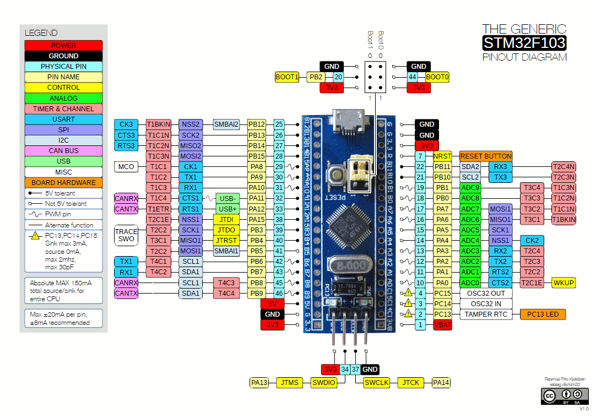

# Módulo 1: GPIOs (General Purpose Input/Output) en STM32

## 1. Título y Objetivos
*   **Título:** Configuración y Control de Puertos de E/S Digitales (GPIO) en STM32F103C8T6.
*   **Objetivos:**
    *   Comprender los conceptos fundamentales de GPIO, puertos y pines en microcontroladores.
    *   Analizar los modos de configuración eléctrica de un pin GPIO (Push-Pull, Open-Drain, Pull-Up/Pull-Down).
    *   Dominar el uso de las funciones esenciales de la HAL (`WritePin`, `ReadPin`, `TogglePin`) para el control de entradas y salidas digitales.
    *   Introducir el concepto de gestión de tiempos no bloqueantes mediante `HAL_GetTick()`.

## 2. Especificaciones del Circuito
*   **Microcontrolador:** STM32F103C8T6 (Blue Pill, ARM Cortex-M3 a 72 MHz)[cite: 1].
*   **Diagrama de Pines de Referencia:**

[cite: 1]

*   **Periféricos Asociados:** 
    *   LED indicador en el pin `PC13` (on-board, activo en bajo).
    *   Pulsador digital conectado en `PA0`.

## 3. ¿Qué es un GPIO, un Puerto y un Pin?
Antes de configurar el hardware, es fundamental clarificar los conceptos básicos de la E/S digital:
*   **GPIO (General Purpose Input/Output):** Son los "pines de propósito general" del microcontrolador. Esto significa que el software puede configurar dinámicamente el comportamiento del pin para que funcione como una **entrada** (para leer botones, sensores digitales, etc.) o como una **salida** (para encender LEDs, activar relés, enviar señales de control, etc.).
*   **Pin:** Es la terminal física del chip (o de la placa Blue Pill) que conecta el circuito interno de silicio con el mundo exterior mediante pistas y cables.
*   **Puerto:** Es un grupo organizado de pines (en el STM32 son conjuntos de 16 pines) que comparten una misma estructura de control y alimentación (por ejemplo, el **Puerto A** agrupa desde `PA0` hasta `PA15`, y el **Puerto C** agrupa desde `PC0` hasta `PC15`).

## 4. Modos de Configuración de Pines GPIO
*   **Salida Push-Pull:** Modo estándar para la gran mayoría de salidas (LEDs, actuadores), manejando niveles altos (3.3V) y bajos (0V) de forma activa mediante transistores internos.
*   **Salida Open-Drain:** El pin actúa solo hacia GND de forma activa; requiere una resistencia de pull-up externa para llevar la línea a nivel alto. Útil para buses o niveles de voltaje mixtos.
*   **Entrada Floating (Flotante):** Sin resistencias internas activas; el pin queda libre y puede captar ruido eléctrico si no se conecta a una referencia fija externa.
*   **Entrada Pull-Up / Pull-Down:** Activa resistencias internas débiles hacia VCC o GND para asegurar un estado lógico estable (alto o bajo) cuando el pin no está siendo pilotado por una fuente externa.

## 5. Funciones Esenciales de Control: `WritePin`, `ReadPin` y `TogglePin`

Para interactuar de forma directa con el hardware a través de la HAL, utilizamos tres funciones fundamentales:

### A. `HAL_GPIO_WritePin()` (Control de Salidas)
Permite establecer un nivel lógico específico en un pin configurado previamente como salida.
*   **Sintaxis:** `HAL_GPIO_WritePin(GPIOx, GPIO_Pin, PinState);`
*   **Parámetros:** `GPIOx` (Puerto), `GPIO_Pin` (Pin) y `PinState` (`GPIO_PIN_SET` para 3.3V o `GPIO_PIN_RESET` para 0V).
*   **Ejemplo:** `HAL_GPIO_WritePin(GPIOC, GPIO_PIN_13, GPIO_PIN_RESET);` (Enciende el LED on-board de la Blue Pill).

### B. `HAL_GPIO_ReadPin()` (Lectura de Entradas)
Permite consultar en tiempo real el estado lógico presente en un pin configurado como entrada.
*   **Sintaxis:** `GPIO_PinState estado = HAL_GPIO_ReadPin(GPIOx, GPIO_Pin);`
*   **Retorno:** Devuelve `GPIO_PIN_SET` o `GPIO_PIN_RESET` según el voltaje detectado.
*   **Ejemplo:** Evaluar si un botón con Pull-Up interno fue presionado (`if (HAL_GPIO_ReadPin(GPIOA, GPIO_PIN_0) == GPIO_PIN_RESET)`).

### C. `HAL_GPIO_TogglePin()` (Inversión de Estado)
Invierte de forma automática el estado lógico actual de un pin de salida.
*   **Sintaxis:** `HAL_GPIO_TogglePin(GPIOx, GPIO_Pin);`
*   **Uso típico:** Alternar el estado de un LED (parpadeo) sin necesidad de evaluar su condición previa.

## 6. Plus Profesional: Retardos No Bloqueantes con `HAL_GetTick()`
Si bien `HAL_Delay()` es útil para pruebas rápidas, detiene por completo la ejecución del procesador (es **bloqueante**). En proyectos avanzados de robótica, el microcontrolador no puede darse el lujo de quedarse esperando congelado.
*   **¿Cómo funciona?** `HAL_GetTick()` retorna la cantidad de milisegundos transcurridos desde que el microcontrolador arrancó (gracias al SysTick). 
*   **Patrón básico sin bloqueo:** Guardas el tiempo anterior en una variable `uint32_t` y comparas si la diferencia con `HAL_GetTick()` supera tu intervalo deseado, permitiendo que el bucle `while(1)` siga leyendo sensores y controlando motores libremente mientras tanto.

## 7. Conclusión
El dominio de los GPIOs, sus configuraciones eléctricas y las funciones de control de la HAL establecen los cimientos indispensables para desarrollar firmware robusto y escalable en arquitecturas ARM Cortex-M.